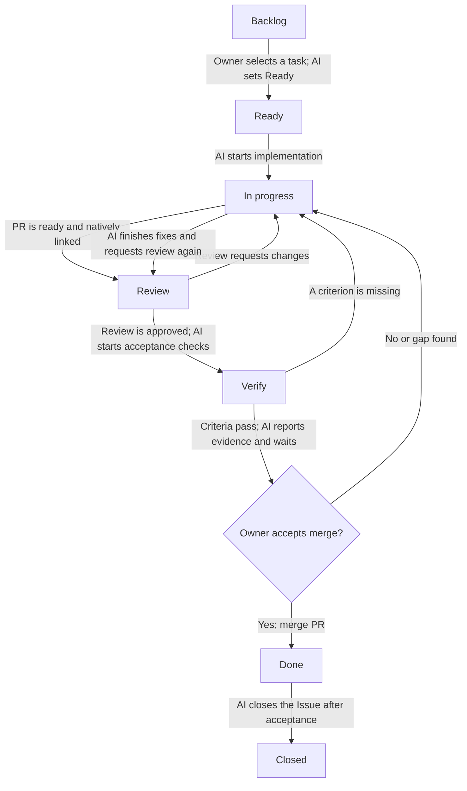

# GitHub Project workflow

Email Support Project #15 keeps one execution item per task: the Issue. Pull requests are linked to that Issue through GitHub's native Development relationship and never become separate Project items.

## Status flow



The Project's native workflows set `Review` when a pull request is linked to an Issue, `In progress` when a review requests changes, and `Done` when the pull request is merged. AI sets `Verify` before merge, after review is approved and acceptance checks pass. If verification finds a gap, AI returns the Issue to `In progress` and continues the work. The owner accepts the verified result and authorizes merge; merge then moves the Issue to `Done`. AI closes the Issue after merge. Keep the Project's `Auto-close issue` workflow disabled.

Also keep the repository setting **Settings → Issues → Auto-close issues with merged linked pull requests** disabled. This is separate from the Project workflow: GitHub can close an Issue when its natively linked PR is merged even if the Project's `Auto-close issue` workflow is off. The repository setting is verified off for this workflow. AI closes the Issue after the owner accepts and the verified PR is merged. See [GitHub's setting documentation](https://docs.github.com/en/repositories/managing-your-repositorys-settings-and-features/managing-repository-settings/managing-auto-closing-issues).

AI sets selection and implementation states with the repository command:

```sh
scripts/project-status.sh <issue-number> "Ready"
scripts/project-status.sh <issue-number> "In progress"
scripts/project-status.sh <issue-number> "Review"
scripts/project-status.sh <issue-number> "Verify"
scripts/project-status.sh <issue-number> "Done"
```

The command changes only the Status field of exactly one matching Issue item in Project #15. It discovers the field and option IDs from the live Project schema and stops without writing if the Issue item or target status is missing or ambiguous. It never closes an Issue.

## AI operating rules

- When the owner asks AI to choose/brainstorm the next task or names a specific task, identify its Issue. Move that Issue to `Ready` when the owner selects it; ask if the Issue match or scope is ambiguous.
- Move the selected Issue to `In progress` when implementation begins. Keep it there while implementing fixes or filling verification gaps.
- Create/link a PR only when it is ready for review. Keep a draft PR unlinked until it is ready; the native link workflow moves the Issue to `Review`.
- When a review requests changes, continue the work and leave the Issue in `In progress`. After the changes are ready, request review again and use the command above to move the already-linked Issue to `Review`.
- After review approval, check every acceptance criterion and run the required verification before merge. If one is missing or a check fails, move the Issue to `In progress` and continue.
- When verification passes, report evidence and keep the Issue in `Verify` while awaiting explicit owner acceptance and merge authorization. A failed acceptance returns it to `In progress`.
- Merge only after the owner accepts the verified result. The native merge workflow moves the Issue to `Done`; AI then closes it. Keep both auto-close settings above disabled so closure happens only after this sequence.
- For blocked work, keep the current status, add the `blocked` label, and record the dependency and next action on the Issue.

## Pull request creation

Set the owning Issue's Type when creating the Issue (`Feature`, `Bug`, or `Task`). GitHub does not support Issue Type on pull requests; set Type on the Issue. Before creating a PR, read the owning Issue's labels and milestone. Set PR metadata in the creation command: assign it to the configured developer account, request review from the configured tech lead, and copy every Issue label and its milestone. Replace the username placeholders in this example with the repository's configured accounts:

```sh
gh pr create \
  --assignee "<developer-github-username>" \
  --reviewer "<tech-lead-github-username>" \
  --label "<issue-label>" \
  --milestone "<issue-milestone>"
```

Repeat `--label` once per label on the Issue. Link exactly one owning Issue through the PR's native **Development** relationship when the PR is ready for review. Do not use `Fixes`, `Closes`, or `Resolves` in the PR body. These keywords are not the protection against merge closure: both auto-close settings must remain disabled. A plain `Refs #N` mention does not create the native relationship.

The native `Pull request merged` workflow sets `Done` regardless of the Issue's current Status. AI and the owner must follow the pre-merge `Verify` and acceptance gate before merging; GitHub does not enforce that Status prerequisite in this workflow.
