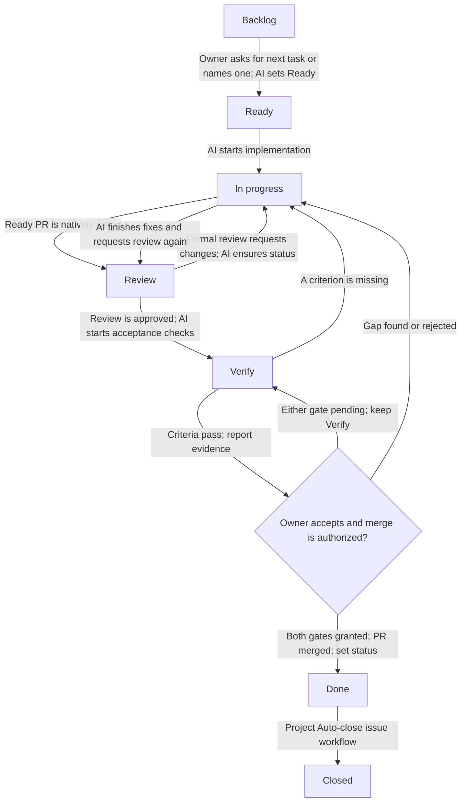

# GitHub Project workflow

Email Support Project #15 keeps one execution item per task: the Issue. Pull requests are linked to their scoped Issues through GitHub's native Development relationship and never become separate Project items.

## Status flow



The enabled `Pull request linked to issue` workflow moves the Issue to `Review`. The `Code changes requested`, `Code review approved`, and `Pull request merged` workflows update PR items; since this Project keeps only Issues, AI checks the Issue and uses the helper after a change request, approval and verification, or owner-authorized merge. `Auto-close issue` closes the Issue when its Status reaches `Done`. See [GitHub's built-in workflow guide](https://docs.github.com/en/issues/planning-and-tracking-with-projects/automating-your-project/using-the-built-in-automations).

Keep the repository setting **Settings → Issues → Auto-close issues with merged linked pull requests** disabled. This is separate from the Project workflow: it closes a linked Issue directly on PR merge, regardless of Project Status. Here, the Project's `Auto-close issue` workflow closes the Issue only when its Status changes to `Done`. See [GitHub's setting documentation](https://docs.github.com/en/repositories/managing-your-repositorys-settings-and-features/managing-repository-settings/managing-auto-closing-issues).

AI sets selection and implementation states with the repository command:

```sh
scripts/project-status.sh <issue-number> "Ready"
scripts/project-status.sh <issue-number> "In progress"
scripts/project-status.sh <issue-number> "Review"
scripts/project-status.sh <issue-number> "Verify"
scripts/project-status.sh <issue-number> "Done"
```

The command changes only the Status field of exactly one matching Issue item in Project #15. It discovers the field and option IDs from the live Project schema and stops without writing if the Issue item or target status is missing or ambiguous. It never closes an Issue.

## AI operating rules

- When the owner asks AI to brainstorm the next task or names a task, identify its Issue and move it to `Ready`; ask only if the Issue match or scope is ambiguous.
- Move the selected Issue to `In progress` when implementation begins. Keep it there while implementing fixes or filling verification gaps.
- Create/link a PR only when it is ready for review. Keep drafts unlinked; native linking moves the Issue to `Review`. For a follow-up PR on an accepted, closed Issue, restore `Done` after linking and keep it through review and merge; reopen only if its accepted scope needs new verification.
- For active, unaccepted work, move the Issue to `In progress` on a formal change request and back to `Review` after fixes if automation did not.
- After formal review approval, move unaccepted work to `Verify` and check every acceptance criterion. If a criterion is missing or a check fails, move it to `In progress` and continue.
- When verification passes, report evidence and keep the Issue in `Verify` until owner acceptance and merge authorization. Review, green CI, and merge do not imply acceptance; rejection returns the Issue to `In progress`. If merge is authorized first, keep it in `Verify` and open until acceptance.
- At acceptance, check verified criteria/evidence and clear stale PR actions. Set `Done` only after acceptance and merge, then verify auto-close; leave the Issue open if criteria remain unverified.
- Keep PR bodies concise and within the three sections in `.github/pull_request_template.md`; track acceptance on the Issue and Project.
- For blocked work, keep the current status, add the `blocked` label, and record the dependency and next action on the Issue.

## Pull request creation

Set the owning Issue's Type when creating the Issue (`Feature`, `Bug`, or `Task`). GitHub does not support Issue Type on pull requests; set Type on the Issue. Before creating a PR, read the owning Issue's labels and milestone. Set PR metadata in the creation command: use the owning Issue's assignee, request review from the configured tech lead when different from the author, and copy the relevant Issue labels and milestone. GitHub does not allow authors to review their own PRs. Replace the username placeholders in this example with the repository's configured accounts:

```sh
gh pr create \
  --assignee "<issue-assignee>" \
  --reviewer "<tech-lead-github-username>" \
  --label "<issue-label>" \
  --milestone "<issue-milestone>"
```

Repeat `--label` once per label on the Issue. Link each explicitly owner-selected Issue covered by the PR through the native **Development** relationship when the PR is ready for review. One PR may cover related Issues, but scope, verification, acceptance and Project status remain independent for each Issue. A shared PR never authorizes starting another Issue or marking all linked Issues complete. Copy the relevant labels and shared milestone; use the existing status helper separately for each Issue. Do not use `Fixes`, `Closes`, or `Resolves` in the PR body; the Project Status transition controls Issue closure. A plain `Refs #N` mention does not create the native relationship.
