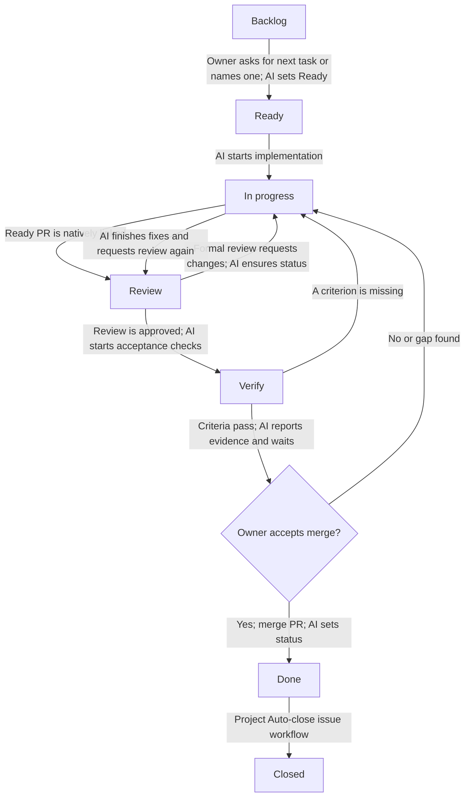

# GitHub Project workflow

Email Support Project #15 keeps one execution item per task: the Issue. Pull requests are linked to that Issue through GitHub's native Development relationship and never become separate Project items.

## Status flow



The enabled `Pull request linked to issue` workflow moves the Issue to `Review`. The `Code changes requested`, `Code review approved`, and `Pull request merged` workflows update PR items; since this Project keeps only Issues, AI checks the Issue and uses the helper after a change request, approval and verification, or owner-authorized merge. `Auto-close issue` closes the Issue when its Status reaches `Done`. See [GitHub's built-in workflow guide](https://docs.github.com/en/issues/planning-and-tracking-with-projects/automating-your-project/using-the-built-in-automations).

Keep the repository setting **Settings → Issues → Auto-close issues with merged linked pull requests** disabled. This is separate from the Project workflow: it closes a linked Issue directly on PR merge, regardless of Project Status. Here, the Project's `Auto-close issue` workflow closes the Issue only when its Status changes to `Done`. See [GitHub's setting documentation](https://docs.github.com/en/repositories/managing-your-repositorys-settings-and-features/managing-repository-settings/managing-auto-closing-issues).

AI sets selection and implementation states with the repository command:

```sh
scripts/project-status.sh <issue-number> "Ready"
scripts/project-status.sh <issue-number> "In progress"
scripts/project-status.sh <issue-number> "Review"
scripts/project-status.sh <issue-number> "Verify"
scripts/project-status.sh <issue-number> "Done"
```

The command changes only the Status field of exactly one matching Issue item in Project #15. It discovers the field and option IDs from the live Project schema and stops without writing if the Issue item or target status is missing or ambiguous. It never closes an Issue.

## AI operating rules

- When the owner asks AI to brainstorm the next task or names a task, identify its Issue and move it to `Ready`; ask only if the Issue match or scope is ambiguous.
- Move the selected Issue to `In progress` when implementation begins. Keep it there while implementing fixes or filling verification gaps.
- Create/link a PR only when it is ready for review. Keep a draft PR unlinked until it is ready; linking a ready PR runs the native workflow that moves its Issue to `Review`.
- When a formal review requests changes, check the Issue status and use the command above to move it to `In progress` if the PR-item workflow did not update it. After fixes are ready, request review again and move the Issue to `Review`.
- After review approval, check every acceptance criterion and run the required verification before merge. If one is missing or a check fails, move the Issue to `In progress` and continue.
- When verification passes, report evidence and keep the Issue in `Verify` while awaiting explicit owner acceptance and merge authorization. A failed acceptance returns it to `In progress`.
- Merge only after the owner accepts the verified result. After the authorized merge succeeds, use the command above to move the Issue to `Done`; the Project's `Auto-close issue` workflow closes it. Keep the repository-level auto-close setting above disabled so closure follows the Project Status transition.
- For blocked work, keep the current status, add the `blocked` label, and record the dependency and next action on the Issue.

## Pull request creation

Set the owning Issue's Type when creating the Issue (`Feature`, `Bug`, or `Task`). GitHub does not support Issue Type on pull requests; set Type on the Issue. Before creating a PR, read the owning Issue's labels and milestone. Set PR metadata in the creation command: assign it to the configured developer account, request review from the configured tech lead, and copy every Issue label and its milestone. Replace the username placeholders in this example with the repository's configured accounts:

```sh
gh pr create \
  --assignee "<developer-github-username>" \
  --reviewer "<tech-lead-github-username>" \
  --label "<issue-label>" \
  --milestone "<issue-milestone>"
```

Repeat `--label` once per label on the Issue. Link exactly one owning Issue through the PR's native **Development** relationship when the PR is ready for review. Do not use `Fixes`, `Closes`, or `Resolves` in the PR body; the Project Status transition controls Issue closure. A plain `Refs #N` mention does not create the native relationship.
