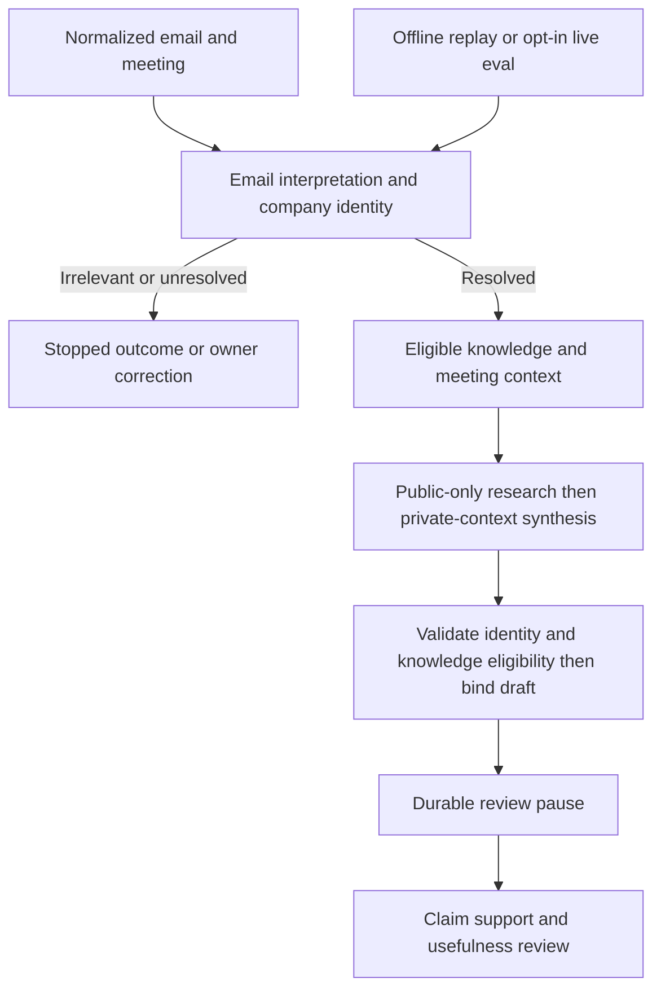

# Phase 4: Resumable briefing and live evaluation

<!-- Updated: Owner-approved red-team R1/R2/R3 - public research isolation, knowledge eligibility and synthetic fixture compatibility. -->

## Outcome, prerequisites and source anchors

Use one production LangGraph factory from bounded CLI and evaluation. Full #8 now resolves identity before research: irrelevant mail exits, ambiguity stops, selected/new companies obtain only their own eligible context. Real research and synthesis persist a cited sealed Markdown version and pending review; PostgreSQL checkpoints survive process restart. No send, promotion, authenticated approval/resume, UI/API route or scheduler is implemented.

Begin after separately reviewed, owner-accepted and authorized merges of #32 → #9 → #8. Read [workflow research including #8 follow-up](../reports/researcher-261027-1322-workflow-evaluation.md), [source map](../reports/scout-261027-1319-briefing-evaluation.md), [architecture](../../docs/02-system-architecture.md), [deployment prerequisites](../../docs/06-deployment-guide.md) and [evaluation rules](../../docs/09-evaluation.md).

Verified existing behavior:

- `create_briefing_version` locks the briefing, increments its version, attaches evidence and seals it (`apps/backend/src/email_support/storage/postgres/persistence/core.py:329–369`); replaying it creates a new version. Run-level idempotency must be added outside this operation.
- Pending review cannot masquerade as approval: `ApprovalRow` requires action/recipient/version/approved-time data (`apps/backend/src/email_support/storage/postgres/persistence/tables/decisions.py:26–62`). No approval/action row is inserted here.
- `list_eligible_knowledge` filters by company only when a non-null ID is supplied (`apps/backend/src/email_support/storage/postgres/persistence/decisions.py:188–221`). Calling with None would retrieve all companies. Missing identity must stop before that query.
- Database resources and caller-owned sessions are explicit (`apps/backend/src/email_support/storage/postgres/persistence/database.py:11–23`). Provider requests must not run inside SQL transactions.
- Alembic uses canonical Base metadata (`apps/backend/migrations/env.py:15–18,44–52`). Backup uses whole-database custom-format pg_dump (`apps/backend/scripts/test_database.py:601–632`), with guarded migration/drift helpers (`:816–851`). Extend rather than bypass these safeguards.

## Data flow and graph

1. The CLI/evaluator composes private settings, phase-2 adapters/executor, phase-3 input/identity services, SQLAlchemy engine and async Postgres saver. Validate all configuration before network work; create/close resources at the invocation boundary.
2. Load/persist normalized input and run #8 Email/Company Info roles. Relevant resolved input captures immutable source IDs/hash, company/contact/revision and clock/timezone. Irrelevant/ambiguous/uncertain inputs produce explicit stopped outcomes, no unnecessary research or company-wide query.
3. Deterministic Memory/Calendar context operations read eligible canonical knowledge for the exact resolved company and provided normalized meeting. Retain canonical knowledge IDs and immutable version/content identities alongside cached context; recovery revalidates company, sealing, approval linkage and non-invalidation before consuming it. Current contact mapping must still agree. New company legitimately has empty history; missing optional meeting is absence, configured storage failure is an error. No Neo4j/Qdrant/synchronization integration is fabricated.
4. Web Research receives only the phase-2 public research input: public company identifiers explicitly supplied/approved by the local operator and enumerated public topics, separately from private normalized text. Store that input in the immutable run/config identity; neither model output nor sender assertions can approve it. Missing approval stops research rather than using private context as a query. It uses bounded query templates and invocation-scoped source references through the phase-2 executor, retaining snapshots/retrieval time/publication unknowns and source gaps. Raw email, meeting, needs and private knowledge never enter this role's context or outbound search/fetch payloads. Report Generation separately consumes typed public evidence and private needs/context through the configured inference adapter, with no web tools; it returns validated atomic fact/need/meeting claims, suggestions/questions and unknowns. Company facts, email assertions and recommendations remain distinct. Render company overview/products/recent developments/contacts where supported; explicitly show missing or conflicting information instead of inventing it.
5. A distinct persist node calls a service to atomically create evidence, a sealed briefing version, the run/version binding and `pending_review` state. Revalidate input/config hashes, live contact revision and every referenced knowledge item's current eligibility under row locks before binding. Replay returns the existing binding without creating another version.
6. A separate deterministic Human Approval node revalidates the canonical binding, current identity and knowledge eligibility then calls `interrupt` with only run/briefing/version references. It creates no approval. Its restart has no pre-interrupt effects. End the invocation and release resources once the interrupt is durable; never hold a database connection waiting for a human.
7. Inspect/recover commands read canonical run/version/status first, revalidate current identity, referenced knowledge eligibility and hashes, then examine compatible checkpoint state. Revoked or otherwise ineligible cached context stops recovery before consumption; rerun with fresh eligible context under a fresh run UUID. If a version is already bound, preserve it; report invalidated dependencies as non-current rather than regenerating it or presenting it as eligible. Only a still-current binding may repair/re-enter the safe pending-review pause. Never regenerate/overwrite a bound version from a stale checkpoint. #14 later supplies an authenticated exact-version decision service; no CLI `approve`, arbitrary `Command(resume=...)` or effectful resume is exposed here.



Use `TypedDict` only for LangGraph channels/partial updates; validate role inputs/results and final output with Pydantic. Keep identity/config fields immutable, ordinary branch updates narrow, and append-only evidence/events reduced deterministically by stable IDs. Prefer a sequential graph; reducers still must reject conflicting IDs and preserve unrelated state. Seven architecture roles represent real responsibilities, not seven mandatory LLM calls.

## Canonical run ownership, budgets and persistence

Add one small canonical `briefing_runs` table: unique run UUID, normalized source and referenced knowledge IDs/version identities, immutable request/config hashes (including approved public research input), selected company/contact/identity revision, controlled status, optional briefing/version binding, bounded attempt ledger/known usage and timestamps. Keep these bounded dependency references in the existing typed run payload; no general dependency registry. FK/check constraints enforce version/briefing/company consistency and pending review requires a binding. Stored status is not an approval. No general lease/job framework is added.

Use stable run UUID text as LangGraph `thread_id`. A local invocation owns a session advisory lock derived deterministically from that UUID, held on one dedicated SQLAlchemy `AsyncConnection` retaining the same Psycopg physical session. Acquire it in AUTOCOMMIT; provider calls run while no transaction is open. Switch that same connection into a short transaction and bind a fresh `AsyncSession` for canonical operations, then return to autocommit. Never borrow its raw driver connection into the saver or operate two transaction managers on it. Verify this lifetime/isolation transition with the selected SQLAlchemy/Psycopg APIs before relying on it.

Acquisition is nonblocking: another invocation of the same run fails `run_busy`. On acquisition read/lock the run row, validate immutable request/config hashes, and use conditional status/binding updates. Holding the same physical connection means losing the ownership connection aborts its canonical write transaction; cancel the graph/provider tasks and reject further writes. Closed/inactive ownership must never reconnect silently. Hash mismatch under an existing run ID is an error, not a new version.

Persist an attempt reservation in the run's bounded metadata ledger before each external attempt using the executor's application callback; complete it with normalized outcome/usage afterwards. No SQL transaction spans the external request. Retry/restart counts consume the same configured run bounds; a crash after dispatch leaves an attempted/unknown outcome and missing usage, never zero or an automatic free retry. Keep terminal and cumulative attempted usage separate. Refuse monetary guarantees when provider costs cannot be bounded. This ledger contains only IDs/categories/usage, not source or mailbox content.

The saver uses a separate supported Psycopg connection and is not fenced by the advisory lock. Lock loss cancellation limits further work, but an already submitted checkpoint may persist. Treat it as non-authoritative: canonical status/version/identity/request hashes and current knowledge eligibility control inspection, publication and future resume. Tests must demonstrate a stale saver write cannot replace a bound draft, erase canonical pending review or become a valid decision. If selected LangGraph behavior cannot preserve that boundary in local recovery, stop and replan; do not claim distributed fencing or add a lease/namespace framework. Durable worker ownership belongs to its selected jobs issue.

Identity corrections increment the #8 revision. Final persistence and inspection/recovery compare under contact row lock. A correction that follows a completed pending-review write makes it stale on the next inspection; do not expose it as current or resume it. Rebuild corrected input under a fresh run UUID. Preserve historical sealed output and its original identity instead of mutating it.

Knowledge invalidation is independent of contact revision. Re-query eligibility from canonical rows before consuming recovered context and inside the final binding transaction; `get_knowledge` alone is insufficient because it accepts invalidated sealed rows. Lock referenced knowledge rows in stable ID order after the contact lock, and perform a fresh eligibility read while holding those locks until binding commits. This orders final binding against the invalidator's row update without keeping transactions open during provider calls. If invalidation wins, stop as stale context and create no new binding; if binding wins, preserve that historical draft but report it non-current after later invalidation. Tests must cover both orderings, missing/wrong-company/version-mismatched dependencies and crash→invalidate→recover. Do not rewrite sealed history or silently replace context under the same immutable run ID.

## Checkpoint schema and compatibility bootstrap

Resolve/lock compatible LangGraph, checkpoint base/Postgres saver, Psycopg and Python 3.13 versions together early in this phase. No researched upstream version is an approved pin. Test actual import, connection URL adaptation, async lifecycle/row factory/autocommit settings, serializer safety, `thread_id`, interrupt inspection and `durability="sync"` against the installed APIs. Never pass a SQLAlchemy URL to Psycopg unchanged without verified conversion.

Alembic owns the dedicated checkpoint schema and canonical run table; the saver owns its internal tables/migrations via `.setup()`. An explicit guarded bootstrap command verifies the owned target and a full verified backup, applies Alembic, then runs saver setup in that schema. It runs on operator request, never each graph invocation. Saver runtime must fail clearly if setup is missing or incompatible. Confine search_path and permissions; canonical Alembic drift excludes saver-owned objects while still detecting canonical drift. Test setup repeatability and original rows after upgrade, not only fresh installation.

Checkpoint state may contain private normalized text. Keep the database/result storage isolated/protected and serialize only needed typed state or canonical references; no full content in traces. Use safe serializer configuration supported by the selected version. Whole-database backup/restore must include both schemas and pending checkpoints. Document compatible state/schema versions before allowing recovery with changed code; fail closed on mismatch.

## File inventory

Inventory paths are relative to the repository root. Phase 4 owns sequential extensions only after earlier PRs merge. No deletion or unrelated module scaffolding.

| Action | Repo-relative path | Responsibility |
|---|---|---|
| Create | `apps/backend/src/email_support/workflows/__init__.py` | Actual workflow package. |
| Create | `apps/backend/src/email_support/workflows/company_briefing/__init__.py` | Factory facade. |
| Create | `apps/backend/src/email_support/workflows/company_briefing/state.py` | TypedDict channels/partial updates/reducers. |
| Create | `apps/backend/src/email_support/workflows/company_briefing/graph.py` | Shared production factory, node routing and pause. |
| Create | `apps/backend/src/email_support/workflows/company_briefing/runtime.py` | Owned CLI/eval resources and recovery/compatibility checks. |
| Create | `apps/backend/src/email_support/agents/web_research.py` | Bounded Web Research role. |
| Create | `apps/backend/src/email_support/agents/report_generation.py` | Validated synthesis role and Markdown rendering. |
| Create | `apps/backend/src/email_support/agents/human_approval.py` | Deterministic pending-review references only. |
| Create | `apps/backend/src/email_support/agents/context.py` | Typed deterministic Memory/Calendar operations and canonical knowledge dependency references. |
| Create | `apps/backend/src/email_support/services/briefing_runs.py` | Ownership, bounded attempts, identity/knowledge eligibility validation and atomic binding. |
| Create | `apps/backend/src/email_support/models/persistence/briefing_runs.py` | Run contracts/status/binding. |
| Create | `apps/backend/src/email_support/storage/postgres/persistence/briefing_runs.py` | Caller-owned run CAS/binding queries. |
| Create | `apps/backend/src/email_support/storage/postgres/persistence/tables/briefing_runs.py` | Canonical run mapping/constraints. |
| Create | `apps/backend/src/email_support/storage/postgres/checkpoints.py` | Supported saver lifecycle and explicit setup adapter. |
| Create | `apps/backend/migrations/versions/<generated-revision>_briefing_runs_and_checkpoint_schema.py` | Additive run table and saver schema; allocate from actual post-#8 head. |
| Create | `apps/backend/scripts/run_company_briefing.py` | Bounded run/recover/inspect CLI without approval capability. |
| Create | `apps/backend/scripts/bootstrap_checkpoints.py` | Explicit verified-backup bootstrap via guarded target. |
| Create | `apps/backend/tests/unit/workflows/test_company_briefing.py` | State/role/reducer/routing/privacy/claim checks. |
| Create | `apps/backend/tests/database/workflows/test_briefing_runs.py` | Canonical idempotency, ownership, budgets and stale identity. |
| Create | `apps/backend/tests/database/workflows/test_checkpoint_recovery.py` | Setup, process crash/restart, separate-saver race and full restore. |
| Modify | `apps/backend/src/email_support/models/briefing.py` | Shared final output/source provenance required by graph/evaluation. |
| Modify | `apps/backend/src/email_support/tools/execution.py` | Optional typed durable attempt-reservation/completion callback. |
| Modify | `apps/backend/src/email_support/storage/postgres/persistence/tables/__init__.py` | Register run mapping. |
| Modify | `apps/backend/migrations/env.py` | Deliberate saver schema exclusion from canonical drift. |
| Modify | `apps/backend/pyproject.toml` | Compatible dependency set. |
| Modify | `apps/backend/uv.lock` | Resolved tested dependency pins. |
| Modify | `apps/backend/scripts/test_database.py` | Guarded explicit saver-bootstrap operation sharing verified backup lifecycle. |
| Modify | `apps/backend/tests/database/migrations/test_migrations.py` | New head, seeded upgrade/drift and canonical preservation. |
| Modify | `apps/backend/evals/runner.py` | Same production graph in offline/live mode. |
| Modify | `apps/backend/evals/models.py` | Actual workflow result/review/coverage extension. |
| Modify | `apps/backend/evals/datasets/briefing-v1/cases.json` | Version supported checks/baselines with fresh review. |
| Modify | `docs/02-system-architecture.md` | Actual run/checkpoint/authority boundary. |
| Modify | `docs/03-codebase-summary.md` | Actual modules/entry points. |
| Modify | `docs/06-deployment-guide.md` | Minimal local guarded bootstrap/backup/restore and compatibility route. |
| Modify | `docs/09-evaluation.md` | Implemented production-factory commands, reviewed metrics and coverage gaps. |

## Tests Before — RED and scenario matrix

| Scenario | Level | Required proof |
|---|---|---|
| Irrelevant/ambiguous/missing identity | Unit + graph | No research, unfiltered retrieval or briefing publication; explicit stopped reason. |
| New company, returning company, revoked/wrong-company knowledge | Unit + real DB | Empty is valid; only eligible company/source context; dependency failure stays failure. |
| Crash after context checkpoint, then invalidate knowledge and recover | Real DB + subprocess | Recheck canonical dependency IDs/identities before reuse; stop stale recovery, create no new draft and preserve historical output. |
| Knowledge invalidation races final binding or follows binding | Real DB | Stable lock ordering and fresh eligibility read establish ordering: revoked-first rejects binding; bound-first output remains historical and becomes non-current after revocation. |
| Missing/cancelled meeting; stale/missing/conflicting source | Replay + reviewed live | No invented dates/attendance/facts; unknowns and source dates retained. |
| Partial updates/replayed evidence IDs | Unit | Identity and unrelated state preserved; deterministic dedup or conflict rejection. |
| Prompt injection in normalized mail/page requesting private canary search/URL | Contract + reviewed live | Public-only research input and controlled query/source references exclude private mail/meeting/knowledge from actual search payloads/fetch destinations. Synthesis retains needed private context but has no web tools; unsupported semantic claims fail/pending review, no effects. |
| Same run/config repeated; changed input/config; concurrent processes | Real DB | Same bound version; mismatch rejected; run_busy before duplicate work. |
| Ownership connection loss during provider/canonical write | Real DB + subprocess | Cancellation; stale process cannot commit/reconnect canonical writes. |
| Saver writes after lock loss | Real DB | Canonical-first recovery ignores stale state; cannot replace bound draft/status or grant decision. |
| Crash after canonical commit before graph checkpoint/interrupt | Real process | Recovery returns same sealed version and re-establishes pending pause; no duplicate version. |
| Crash before canonical commit | Real process | No partial binding/version; restart respects durable attempt ledger/unknown upstream outcomes. |
| Identity correction races persist or occurs before inspect/recovery | Real DB | Consistent row-lock ordering; old revision is stale/non-current and cannot resume. |
| Migration/drift/setup twice and full backup/restore | Real PostgreSQL | Canonical data plus checkpoints restored; saver schema never hidden canonical drift. |
| Reconstruct process/saver/graph after interrupt | Subprocess + real DB | Same run/thread and pending version; durable state survives actual process exit. |
| Claimed supported text with valid citation but wrong meaning | Evaluation review | Human support remains required; no ID/string-based entailment shortcut. |
| Offline vs live/unreviewed/unsupported and missing usage | Evaluation integration | Honest mode/coverage/unknowns; unsupported effects/export/attachment not pass. |

## Implementation steps and refactor

1. Lock compatible dependencies and prove async saver setup/search_path/serialization/thread/durability APIs plus same-session canonical lock/transaction lifetime. Stop on incompatible behavior before application wiring; do not suppress type/runtime errors.
2. Write the above failing correctness/database/subprocess tests using isolated guarded targets and controlled provider seams. Add additive run/schema migration and explicit backup-before-setup bootstrap; prove preservation/drift/repeatability/whole DB restore.
3. Implement run ownership and canonical binding/idempotency before provider graph work. Integrate durable attempt callbacks without transactions across providers. Persist immutable hash/identity and knowledge dependency snapshots; reject stale identities or ineligible dependencies at recovery/final binding with the specified lock ordering.
4. Build one small graph with real typed roles. Reuse phase-3 input/identity services and phase-2 tool executor. Compose the separately operator-approved public research input without copying private content into that role, and retain private needs/context only for synthesis. No fake retrieval, fabricated source records, seven-LLM-loop ceremony or separate evaluation assistant. Validate all role/claim/evidence outputs, then render and atomically bind the sealed version.
5. Add distinct persist and interrupt nodes. Implement canonical-first run/inspect/recover, releasing connections at pending review. Expose authenticated decision integration seam only as typed future service contract; implement no public resume token/flag or action execution.
6. Reconstruct the graph in a new process against the same saver after controlled crashes. Verify version counts/IDs and review state, lock loss and stale identity/saver cases. Refactor helpers only after these invariants pass.
7. Extend eval runner to the same graph factory: fixed snapshots/clock and boundary replay for offline tests; actual adapters for opt-in live runs. Synthetic identities retain reserved example.com/net/org addresses, unchanged canonical validation and no delivery mapping/capability. Run applicable reviewed cases covering new/returning company, relevance/ambiguity, wrong association, missing evidence/meeting and injection, including observed outbound privacy checks and stale-knowledge recovery. Capture changed live source snapshots. Human-review generated claim/evidence pairs and score meeting usefulness/task outcome separately; remaining scenarios stay unsupported.
8. Record observed baseline metrics and sanitized summaries with actual version/config identities; no arbitrary threshold or full-release claim. Update owning docs after actual commands exist and have run.

## Tests After — GREEN and verification

Proposed new focused path, from `apps/backend`:

```sh
uv run --locked pytest -q tests/unit/workflows/test_company_briefing.py
```

Root existing runner with proposed new test paths, then actual broader gates:

```sh
./scripts/check-database.sh local tests/database/workflows tests/database/migrations tests/database/identity
make backend-check
make database-check
make check
make check-api-drift
```

Run broader gates once focused failures are fixed; repeat only for new changes/failures. No public API change is intended; drift must stay clean. Bootstrap/recovery tests use the real PostgreSQL guarded lifecycle, not SQLite or a checkpointer double.

**Proposed commands, unavailable until implemented**, from `apps/backend`:

```sh
uv run --locked python scripts/bootstrap_checkpoints.py --owned-target PATH_TO_PRIVATE_TARGET_CONFIG
uv run --locked python scripts/run_company_briefing.py run --input PATH_TO_NORMALIZED_INPUT --run-id RUN_UUID
uv run --locked python scripts/run_company_briefing.py inspect --run-id RUN_UUID
uv run --locked python scripts/run_company_briefing.py recover --run-id RUN_UUID
uv run --locked python -m evals run --mode offline --dataset evals/datasets/briefing-v1 --output PATH_TO_PRIVATE_OUTPUT
uv run --locked python -m evals run --mode live --live --dataset evals/datasets/briefing-v1 --output PATH_TO_PRIVATE_OUTPUT
```

Bootstrap validates explicit owned target/backup through the existing lifecycle; it never accepts an arbitrary unverified operational DB URL. CLI run uses real providers; offline mode exists only through explicit eval configuration and is labelled replay. No approval option exists. No tests/provider calls/DB changes were run during planning.

## Acceptance mapping — Issue #13

- [ ] AC1: actual bounded local run produces canonical cited Markdown with verified-source references, stated needs, meeting context, useful questions and unknowns. No invented prior history.
- [ ] AC2: typed roles/IO/allowlists/narrow state updates/reducers pass; identity is resolved by #8; public research isolation and outbound canary checks pass; empty context and dependency failure stay distinct.
- [ ] AC3: real PostgreSQL checkpoints/stable IDs and fresh-process recovery preserve the exact draft/pending review; canonical crash/ownership/revision, revoked-context recovery and invalidation/binding ordering tests pass. Historical invalidated output stays sealed but non-current; no sending/promotion or unauthorized resume exists. #14 owns authenticated decision interface integration.
- [ ] AC4: correlated role/tool/provider execution metadata shows actual path/failures/latency/known usage, without secret/full-body logging.
- [ ] AC5: same graph runner records reviewed applicable live support and human usefulness, including missing evidence, ambiguity and injection; unsupported later features/unreviewed claims remain visible and never pass.

## Risks, backwards compatibility and rollback

| Risk | Likelihood × impact | Mitigation |
|---|---|---|
| Duplicate sealed version after replay | High × High | Atomic run/version binding; existing binding returned before any insert. |
| Lock loss permits stale saver updates | Medium × High | Cancel work; canonical authority and immutable/revision gates; explicit separate-connection race test. |
| Wrong identity survives correction/checkpoint | Medium × High | Revision snapshot/CAS, canonical-first inspect/recovery, fresh run on stale identity. |
| Cached knowledge survives invalidation | Medium × High | Canonical dependency eligibility checks on recovery/final binding, stable row-lock ordering, stale stop and crash/race tests; preserve sealed history. |
| Private context escapes via research tools | High × High | Separate approved public research input, controlled query/source-reference gates, private-context synthesis without web tools and outbound canary tests. |
| Saver schema changes bypass backup/drift | Medium × High | Explicit guarded setup, separate schema ownership, full DB backup/restore and drift test. |
| Unbounded restart retries or unknown cost | Medium × High | Durable attempt reservations, shared bounds, unknown outcomes preserved. |
| Semantic quality looks passed from references | High × High | Human claim/evidence and usefulness review; no thresholds invented. |
| Serialization or version drift breaks recovery | Medium × High | Locked tested set, safe serialization and compatible schema/config version checks. |

Migrations are additive; preserve canonical data and sealed versions. Roll back code only to a revision that understands stored run/checkpoint state, or disable new CLI starts while inspecting/recovering preserved data. Never drop saver/run tables or downgrade source/run schema to make tests green. Before incompatible rollback, stop owned processes, verify a whole-DB backup and restore into an isolated target; retain source evidence and review state. A checkpoint restore cannot reverse external provider usage, and no send/promotion exists to undo. Production deployment and release remain separately authorized work.

Finish only with concrete check/live/restart/restore evidence, reviewer disposition, explicit owner acceptance and authorized merge. This slice does not accept the complete release: synchronization, protected approval/effects and other unsupported scenarios remain owned by their issues. Open evidence: exact installed dependency/connection behavior, actual live source/model quality and human baseline reviews are required execution gates.
